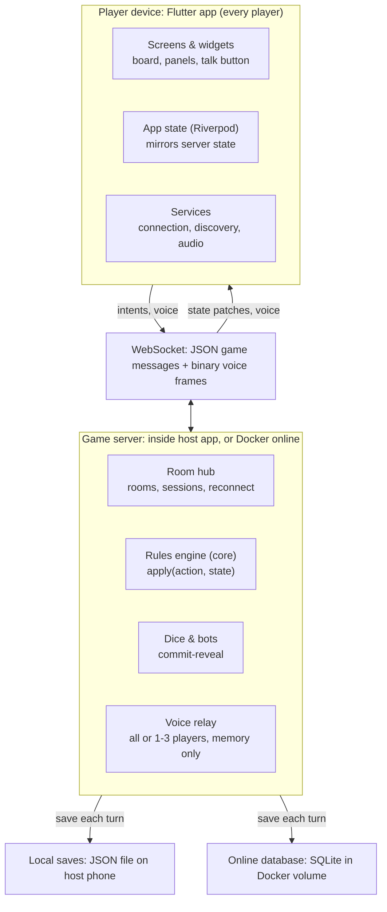
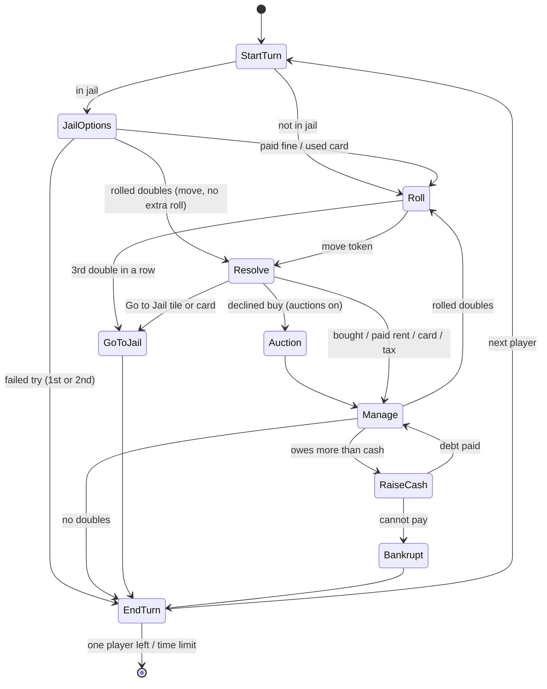
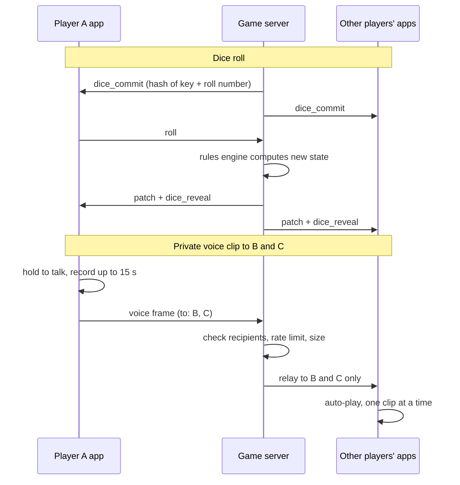
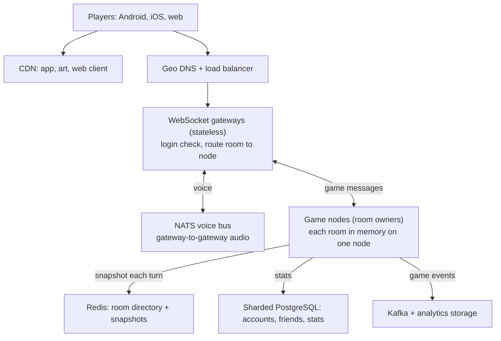

# Vyapari — Design & Architecture

Last updated: 2026-11-03 · Read `requirements.md` first.

Vyapari is one Flutter + Dart codebase. Every device runs the same app, and one device (or an online server) also runs the authoritative game server that owns all state, dice and voice routing.

## 1. System architecture

Four layers: the Flutter app on every device, one WebSocket connection, the authoritative server, and storage.



The rules engine is the **only** code that changes money, ownership or position. Everything else routes messages or draws results.

**Deployment modes** (same server code):

| Mode | Runs where | Network |
| --- | --- | --- |
| Local host | Inside the host's Flutter app (Android foreground service; iOS while app is open) | Hotspot or Wi-Fi, no internet |
| Online | `server_bin` native binary in Docker behind Caddy (TLS) | Internet, `wss://` |

## 2. Tech stack

| Layer | Choice | Why |
| --- | --- | --- |
| Language | Dart everywhere | One language for app, server, rules and bots |
| App | Flutter — Android, iOS, web (desktop optional) | One responsive codebase |
| State management | Riverpod | Predictable UI state driven by server updates |
| Rules engine | Pure Dart package, no I/O, full unit tests | Shared by server, bots and client previews |
| Local server | `shelf` + `shelf_web_socket` inside the host app | Hotspot hosting with no internet |
| Online server | Same server compiled with `dart compile exe`, Docker, Caddy | Home lab or cloud VM |
| Transport | WebSocket: JSON for game, binary frames for voice | One connection for everything |
| Discovery | UDP broadcast (`RawDatagramSocket`) + mDNS (`multicast_dns`); QR (`qr_flutter`, `mobile_scanner`) | Nearby game list, QR fallback |
| Voice | `record` (Opus Android/web, AAC iOS) + `just_audio` | Native mic, reliable auto-play |
| Local saves | JSON files on host | Simple |
| Online persistence | SQLite behind an interface (PostgreSQL later) | Enough for turn-based state |
| Board data | `board.json` + `cards.json` per theme | Swappable boards |
| Testing & CI | `dart test`, Flutter integration tests, GitHub Actions | Catch rule bugs and desyncs early |

## 3. Code structure

One repository, four Dart packages. `core` has no Flutter or network code.

```
vyapari/
├── packages/
│   ├── core/            # pure Dart: models, rules engine, dice, bots
│   │   ├── models/      # GameState, Player, Tile, Ownership, Card, Trade, HouseRules
│   │   ├── rules/       # reducer: apply(action, state) -> (state, events)
│   │   ├── dice/        # CSPRNG + commit-reveal
│   │   └── bots/        # easy / medium / hard strategies
│   ├── protocol/        # message classes + JSON codecs, protocol version, voice frame
│   ├── server/          # rooms, sessions, WebSocket hub, voice relay, discovery
│   └── app/             # Flutter UI
│       ├── screens/     # home, join, lobby, game, results
│       ├── widgets/     # board, tile, player panel, talk button
│       ├── state/       # Riverpod providers
│       └── services/    # connection, discovery, audio, local host
├── assets/boards/india/ # board.json, cards.json, art
├── server_bin/          # main.dart for the Docker online server
└── test/                # rules tests, protocol tests, full-game simulations
```

| Package | Depends on | Runs in |
| --- | --- | --- |
| `core` | nothing | Server, bots, tests, app (move previews) |
| `protocol` | `core` | Server and app |
| `server` | `core`, `protocol` | Host phone (inside app) and Docker |
| `app` | `core`, `protocol`, `server` | Every player device |

## 4. Data model

The whole game is one immutable `GameState`. Every accepted action produces a new state plus a list of events (for animation and the log).

| Entity | Key fields | Notes |
| --- | --- | --- |
| `GameState` | `roomId`, `version`, `phase`, `players[]`, `tiles[]`, `ownership[]`, `currentPlayer`, `bank` {cash, houses=32, hotels=12}, `decks` {vaaippu, undiyal}, `freeParkingPot`, `rules`, `log[]` | `version` increments on every change; clients ignore older versions |
| `Player` | `id`, `name`, `token`, `cash`, `position`, `inJail`, `jailTurns`, `getOutCards`, `doublesInRow`, `isBot`, `botLevel`, `connected`, `bankrupt` | Cash is `int` rupees |
| `Tile` | `index` 0–39, `type` (city, transport, utility, tax, card, corner), `name`, `group`, `price`, `rent[]`, `houseCost`, `mortgageValue` | Static, from `board.json` |
| `Ownership` | `tileIndex`, `ownerId`, `houses` 0–5 (5 = hotel), `mortgaged` | Mutable part of a tile |
| `Card` | `id`, `deck`, `text`, `effect` {type, amount?, target?, perHouse?, perHotel?} | From `cards.json`; shuffled per game from server seed |
| `Trade` | `id`, `from`, `to`, `give` {cash, tiles[], cards}, `get` {…}, `status`, `createdAtVersion` | Re-validated on accept |
| `Auction` | `tileIndex`, `bids` {playerId: amount}, `endsAt`, `minStep` = ₹10,000 | Present only during an auction |
| `Session` | `playerId`, `token`, `deviceName`, `lastSeen` | Rejoin same seat |
| `VoiceClip` | `id`, `from`, `to` (all or 1–3 ids), `durationMs`, `codec`, `bytes` | In memory only until delivered |
| `HouseRules` | `freeParkingPot`, `doubleOnStart`, `auctions`, `noRentInJail`, `quickGame`, `turnTimerSec`, `startingCash` | Set by host in lobby |

**Card effect types:** `collect`, `pay`, `payEachPlayer`, `collectFromEachPlayer`, `moveTo`, `moveBack`, `goToJail`, `getOutOfJail`, `repairs`.

## 5. Network protocol

One WebSocket per player. JSON text frames for game messages, binary frames for voice.

**Envelope (every JSON message):**

```json
{ "v": 1, "type": "roll", "id": "c-1042", "room": "4821", "data": {} }
```

**Voice frame (binary):** `[4-byte header length][JSON header {clipId, from, to, codec, durationMs}][audio bytes]`

| Direction | Type | Purpose |
| --- | --- | --- |
| C → S | `hello` | name, token, protocol version, session token if rejoining, lastVersion |
| C → S | `ready`, `set_rules`, `add_bot`, `kick`, `start` | Lobby (last four host-only) |
| C → S | `roll`, `buy`, `decline`, `bid`, `pay_jail`, `use_card`, `end_turn` | Turn actions |
| C → S | `build`, `sell_building`, `mortgage`, `unmortgage` | Property management |
| C → S | `trade_propose`, `trade_accept`, `trade_reject`, `trade_counter` | Trades |
| C → S | `emote`, `mute_player` | Social (`mute_player` room-wide is host-only) |
| C → S | `chat` | Typed message: text ≤ 200 chars, recipients all or 1–3 ids |
| C → S | voice frame | Clip with recipients: all, or 1–3 player ids |
| S → C | `welcome` | playerId, session token, full state |
| S → C | `state` | Full state (join, reconnect, version gap) |
| S → C | `patch` | Changes since last version + events to animate |
| S → C | `dice_commit`, `dice_reveal` | Fair-dice proof before and after each roll |
| S → C | `error` | Rejected action with reason code (sent only to the sender) |
| S → C | voice frame | Relayed clip, only to its recipients |
| S → C | `chat_msg` | Relayed chat message, only to its recipients (and the sender) |

**Error reason codes (minimum set):** `not_your_turn`, `illegal_phase`, `insufficient_funds`, `not_owner`, `incomplete_set`, `uneven_build`, `no_houses_left`, `no_hotels_left`, `mortgaged`, `trade_invalid`, `host_only`, `room_full`, `bad_code`, `bad_password`, `rate_limited`, `version_mismatch`, `unknown_message`.

**Connection rules:**
- Heartbeat ping every 10 s; player marked disconnected after 20 s without one.
- On reconnect the client sends its last `version`; the server replies with `patch` or full `state`.
- Version mismatch on `hello` → `error: version_mismatch`; the app shows "Please update the app".

## 6. Turn state machine

The client only shows buttons legal in the current phase. Trades may be proposed any time but are applied only between phases.



## 7. Key flows

Every roll and voice clip goes through the server, never player to player.



Players not in the recipient list never receive the clip. The dice hash is sent before the roll so nobody, including the host, can change the result afterwards.

## 8. Screens & responsive layout

| Screen | Shows | Main actions |
| --- | --- | --- |
| Home | Name, token picker, saved servers, app version | Host, Join nearby, Join online, Play vs bots |
| Join | Nearby games list, QR scanner, manual IP, online room code | Join a room |
| Lobby | Room code + QR, players with ready ticks, house rules (host), bot seats | Ready, Start (host), talk button |
| Game | Board, current turn, dice, players' cash, owned cities, activity log | Roll, Buy, Build, Trade, Mortgage, talk button |
| Results | Winner, net-worth ranking | Rematch, Home |

| Width | Devices | Game layout |
| --- | --- | --- |
| < 600 px | Phones portrait | Board full width; action bar at bottom; panels as slide-up sheets |
| 600–1023 px | Phones landscape, small tablets | Board left; one side panel with tabs (players, my cities, log) |
| ≥ 1024 px | Tablets, laptops, TVs | Board centre; players left; my cities + log right |

- Board drawn with `CustomPainter` on a square sized to the shortest screen side; tile text never below 10 px.
- Talk button floats bottom-right on every layout: long-press records; tap opens the recipient picker.
- Incoming clips show a speaking banner at the top (name, token, "private" badge).

## 9. Deployment, security & testing

| Mode | How it runs | Ports |
| --- | --- | --- |
| Local host | Server starts inside the app on "Host"; Android foreground service keeps it alive with screen off | WebSocket 47800, UDP discovery 47801 |
| Online | `server_bin` via `dart compile exe`, Docker image < 50 MB, Caddy for TLS, `/health` endpoint | 443 public, 47800 internal |

**Security and fairness**
- Clients send intents only; the rules engine rejects anything illegal.
- Dice: before each roll send SHA-256(key + roll number); after the roll reveal the key; key rotates per game. A "Verify dice" view in the log checks it.
- Room codes: random 4 digits local, 6 characters online; optional password; 5 wrong attempts → device blocked 1 minute.
- Online traffic always `wss://`. Voice clips never written to disk.
- Server rejects unknown message types; protocol fuzz-tested.

**Testing**
- Unit tests for every rule in `core`.
- Simulation: 1,000 bot games per push, 10,000 nightly; assert no crash, no stuck game (>500 turns), money conserved after every action.
- Protocol round-trip tests for every message.
- Device test: low-end Android (3 GB RAM) hosting 6 players over hotspot for 90 minutes.

## 10. Scaling to 100 million users (online mode only)

Hotspot and LAN games use no servers, so they scale for free. The online mode scales by splitting into stateless gateways and room-owning game nodes. **The internal build is a single Docker server**; the game code (`core`, `server`) stays the same at every stage.

### Capacity estimate (assumptions)

| Measure | Assumption | Peak load |
| --- | --- | --- |
| Registered users | 100 million | — |
| Daily active | 10% | 10 million |
| Online at peak | 10% of daily active | 1 million connections |
| Rooms at peak | 4 players/room | 250,000 rooms |
| Game messages | 1 action/player/5 s | 200k msg/s in, ~800k msg/s out |
| Voice | 1 clip/player/min, ~20 KB, heard by 3 | ~330 MB/s in, ~1 GB/s out |
| Room state | ~200 KB/room | ~50 GB in memory total |
| Gateways | 100k connections/node | 10 nodes (run 20) |
| Game nodes | 5,000 rooms/node (8 vCPU, 16 GB) | 50 nodes (run 75) |

### Scaled architecture



### Design rules
1. **Room = unit of scale.** Each room lives on exactly one game node, in memory; no shared DB or locks during play.
2. **Stateless gateways** hold connections, check tokens and forward to the room's node.
3. **Room directory** in Redis: room code → game node.
4. **Snapshot every turn** to Redis; on node failure another node loads it and players reconnect.
5. **Voice bypasses game nodes** via NATS between gateways.
6. **Accounts** in PostgreSQL sharded by user id (or YugabyteDB); never touched per move.
7. **History as events** to Kafka, then cheap storage.
8. **Same code, more machines.**

### Operations
- Kubernetes in Mumbai and Hyderabad, autoscaling on connections and rooms per node.
- CDN for app downloads, art and web client.
- Deploys drain game nodes by moving rooms at turn boundaries.
- Prometheus + Grafana, OpenTelemetry; alerts on reconnect rate, turn latency, voice bandwidth.
- Load test with headless Dart bots to 1.5 million players before big launches.

### Growth stages

| Stage | Peak online | Setup |
| --- | --- | --- |
| Internal (now) | < 1,000 | One Docker server on home lab, SQLite |
| Public launch | ≤ 100,000 | 2 gateways + 5 game nodes, Redis, managed PostgreSQL, one region |
| Large scale | ≤ 1 million | Full design above, two regions, sharded accounts, NATS, Kafka |
